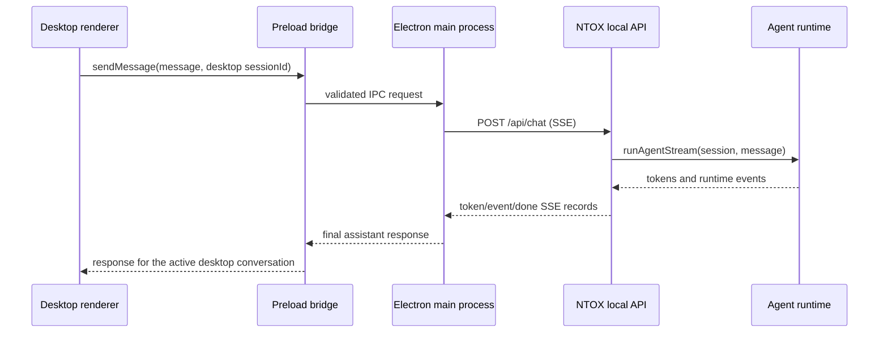

# NTOX Desktop App: Frontend and Backend Architecture

## Purpose

NTOX will have two distinct user interfaces:

1. **NTOX Web Chat** remains the browser-based chat gateway. It is for a user who wants to chat with the NTOX web app.
2. **NTOX Desktop** is a locally installed desktop command center for the local NTOX runtime. It has its own chat, conversations, agent fleet, task orchestration, memory, tools, evaluations, and settings views.

The two chat surfaces are separate products. They must not reuse one visible chat pane or one conversation list. The desktop chat uses desktop-specific session IDs and desktop conversation history. Both may use the same configured local NTOX model, skills, tools, and durable memory where that is intentional.

## Framework decision

The first implementation uses **Electron** with HTML, CSS, and JavaScript for the renderer and Node.js for the privileged desktop process. The NTOX codebase already runs on Node.js and is written in TypeScript, so Electron lets the desktop app call existing runtime services without maintaining a second implementation of config loading, provider routing, memory, and tools.

Rust/Tauri remains an option if memory footprint, installer size, or native window behavior becomes a measured problem. Replacing Electron with Rust now would require a Rust-to-Node bridge or a separately maintained runtime interface. Keep runtime logic in NTOX services so a future shell change does not move agent logic into the window layer.

Electron is currently set to `^45.0.0`, the stable release listed by the Electron project on October 21, 2026. Keep Electron on a supported release and update promptly for security fixes. The renderer runs with context isolation, Node integration disabled, and sandboxing enabled. See the [Electron 45 release](https://www.electronjs.org/blog/electron-45-0) and [Electron security guidance](https://www.electronjs.org/docs/latest/tutorial/security/).

## Current repository structure

```text
desktop/
├── index.html          Desktop shell and workspace markup
├── dashboard.js        Overview, agents, tasks, memory, tools, evaluations, settings
├── dashboard.css       Monochrome command-center visual system
├── chat.js             Desktop conversation list, history, composer, API client
├── chat.css            Desktop-only chat layout and responsive rules
├── main.cjs            Electron main process and local API lifecycle
├── preload.cjs         Small, validated renderer-to-main IPC surface
└── package.json        Electron desktop development dependency and launch script

web/
├── index.html          Browser-only NTOX chat
├── app.js              Existing Socket.IO chat client
└── app.css             Browser chat styles; grayscale in light and dark themes

src/
├── api/server.ts       Local HTTP/SSE chat API
├── core/               Agent, providers, configuration, dispatcher
├── gateway/            Web chat and other messaging channels
├── kernel/             Goals, state, decision and verification services
├── memory/             Episodic, durable, theory and user memory
├── tools/              Tool registry and tool implementations
└── evaluation/         Evaluation runner and benchmark data
```

The desktop renderer is separate from `web/index.html`; it does not embed the web app or its Socket.IO conversation UI. The browser chat remains served by the existing web gateway.

## Frontend architecture

### Shell and navigation

The desktop app opens to a single command-center window with persistent navigation for:

- Overview
- Agents
- Tasks
- Memory
- Tools
- Evaluations
- Settings
- Desktop Chat

The overview screen summarizes current runtime health and recent work. Each section has its own page content and retains the same black, white, and gray visual language. The desktop chat is a dedicated full workspace with a conversation list, message history, composer, runtime status, and optional context panel for active agents and memory.

### Desktop chat

Desktop chat requirements:

- Create, select, search, clear, and persist desktop conversations.
- Keep each conversation's message history separate from browser chat history.
- Give every conversation an independent NTOX session ID prefixed with `desktop_`.
- Stream assistant output and relevant events into the message view.
- Surface runtime startup, provider, tool, policy, and API errors in the conversation.
- Show the agents and memory available to the current request when the runtime can report them.
- Support keyboard send (`Enter`), line breaks (`Shift+Enter`), and a new-chat shortcut (`Ctrl/Cmd+N`).
- Make the current conversation visibly private to the local desktop session.

The renderer stores conversation metadata and message history through a narrow Electron IPC bridge in `app.getPath("userData")/desktop-conversations.json`. The store is bounded to 80 conversations and 200 messages per conversation. Agent session state remains in the NTOX runtime; this file is a desktop transcript/history store, separate from browser chat and NTOX memory.

### Dashboard sections

**Overview** combines runtime health, active agent count, current parallel work, resource summaries, workflow progress, and recent activity.

**Agents** shows identity, role, lifecycle status, current task, last activity, latency, confidence, and permitted actions. Controls should support inspect, pause, resume, configure, deploy, and retire when those backend operations exist.

**Tasks** contains a workflow pipeline, task queue, throughput chart, task filters, progress, dependencies, assigned agents, logs, artifacts, cancellation, retry, and verification status.

**Memory** visualizes connected memory records, recent writes, type distribution, integrity, retrieval time, utilization, and data sources. A memory record must be inspectable, attributable to its source, and subject to configured retention and deletion rules.

**Tools** lists registered capabilities, category, permission requirements, enabled state, availability, health, and usage. The page must explain which agents can call a tool and which actions require approval.

**Evaluations** shows suites, run history, pass rates, capability, safety and reliability trends, evidence traces, and failures. A score must link to the run, dataset version, agent version, and verifier evidence that produced it.

**Settings** configures workspace behavior, default model/provider, concurrency, memory retention, approvals, local API port, startup behavior, and privacy. Secrets stay in the NTOX config or operating-system credential storage; they are never returned to the renderer.

### Current implementation status

The Electron renderer now reads runtime-backed data through the local API: health and process resources, actual subagent runs, persisted desktop workflows, NTOX episodic and durable memory, registered tools, longitudinal evaluation reports under `experiments/meta-eval`, and allowlisted non-secret settings. The dashboard refreshes runtime data every five seconds while visible. It does not synthesize sample evaluation scores or pretend that unavailable agent controls are live.

Task workflows are stored in `desktop-workflows.json` under the NTOX data directory. A user can submit one goal and up to three explicit subtask prompts. Each is launched through NTOX's existing isolated subagent runner with a bounded read/research tool set; the current runtime's subagent concurrency cap is three and each subagent has its existing timeout. Workflow/task state is reconciled against persisted subagent runs when the desktop API is read. Cancel and retry operations are available. This first pass does not yet perform LLM planning, dependency scheduling, isolated writable workspaces, artifact storage, verification, or a replayable workflow SSE stream. Do not assign concurrent subagents conflicting write access.

The desktop chat is a separate conversation surface. It streams API token events to the Electron renderer over IPC, supports cancellation, persists its transcript through the main process, and uses `desktop_<conversation-id>` session IDs. The desktop API starts on demand if one is not already listening. Run `npm run build`, install Electron from `desktop/package.json`, then start the app from `desktop/` with `npm start`.

## Backend architecture

### Process ownership

The Electron **main process** owns the desktop window, local API lifecycle, configuration access, and privileged IPC. The **renderer** owns visual state only. The renderer has no direct Node.js, filesystem, shell, or secret access.

When the desktop app starts, it checks the configured local NTOX API health endpoint. If an API is already available, the app reuses it. If no API is available, the main process starts `node dist/index.js api` in the repository/runtime directory and waits for the health endpoint. The process it starts is stopped when the desktop app exits. An API process that was already running is not stopped by the desktop app.

Configuration is loaded from the same NTOX configuration location as the runtime: `$NTOX_DIR/config.json` when `NTOX_DIR` is set, otherwise `~/.ntox/config.json`. The current API port defaults to `3100`; the API auth token is read only in the main process and supplied only to local requests from that process.

### Current chat request path



The API already has `GET /api/health`, `POST /api/chat`, and `POST /api/session/reset`. Chat requests carry a unique `desktop_<conversation-id>` session ID, so browser chat sessions and desktop sessions do not share transcript state. Both clients can still use the same configured agent factory and durable memory infrastructure.

The Electron main process forwards API SSE records over IPC as they arrive. The renderer appends token records live; tool, phase, memory, and usage events remain available to the bridge and can be added to the conversation activity display. Canceling a request aborts the main-process fetch, closes the API response, and propagates an `AbortSignal` into `runAgentStream`.

### IPC contract

Only the following narrow API is exposed by `preload.cjs`:

```ts
interface NtoxDesktopApi {
  sendMessage(input: {
    requestId: string;
    sessionId: `desktop_${string}`;
    message: string;
  }): Promise<string>;

  cancelMessage(requestId: string): Promise<boolean>;

  onChatEvent(callback: (event: { requestId: string; event: string; data: unknown }) => void): () => void;

  request(input: { route: string; method?: string; body?: unknown }): Promise<unknown>;

  loadConversations(): Promise<unknown[]>;

  saveConversations(conversations: unknown[]): Promise<boolean>;

  getRuntimeStatus(): Promise<{
    connected: boolean;
    port: number;
  }>;

  getSecretStoreStatus(): Promise<{
    encrypted: boolean;
    activeProvider: string;
    storedProviders: string[];
  }>;

  saveCredential(input: { provider: string; apiKey: string; baseUrl?: string }): Promise<{
    stored: boolean;
    encrypted: boolean;
  }>;

  deleteCredential(input: { provider: string }): Promise<{ deleted: boolean }>;

  testCredential(input: { provider: string; apiKey: string; baseUrl?: string }): Promise<{
    ok: boolean;
    provider: string;
    modelCount?: number;
    error?: string;
  }>;

  reloadRuntime(): Promise<unknown>;
}
```

The main process checks that each IPC request came from the app's own renderer, limits message and session lengths, verifies the desktop session ID format, and adds the API bearer token when one is configured. Do not expose raw `ipcRenderer`, Node APIs, the shell, arbitrary file access, or arbitrary HTTP requests to renderer code.

### Secret handling

Secrets are never part of the renderer's data model. The desktop keeps them write-only and encrypted at rest:

- **Storage.** Provider keys live in `~/.ntox/credentials.enc.json`, an OS-keystore blob (`safeStorage`: DPAPI on Windows, Keychain on macOS, libsecret on Linux). When the keystore is unavailable, the fallback is `~/.ntox/credentials.json` with permissions restricted to the current user (`icacls /inheritance:r` on Windows, `chmod 0600` otherwise). `~/.ntox/config.json` holds no secret values at all.
- **Delivery to the runtime.** The Electron main process decrypts the blob and passes the active provider's key to the API child process through its environment (`NTOX_API_KEY`, `NTOX_API_KEY_PROVIDER`), never through `argv`. Nothing encrypted on disk is readable by another account.
- **Write-only contract.** `GET /api/settings` returns `{ configured, masked, source }` per provider and never a key. A `PATCH /api/settings` carrying any secret field is rejected with `400`. `PUT /api/settings/credentials/:provider` stores a key and returns only masked status. `POST …/:provider/test` validates a candidate key without persisting it.
- **Redaction.** `src/core/redact.ts` registers every known secret on config load and scrubs registered values plus key-shaped patterns from API error bodies, SSE error events, and desktop `console.error` output.
- **Auth.** When the desktop owns the API process it generates a per-launch bearer token and requires it on every route except `/api/health`. Reusing an externally started API falls back to the configured token.
- **Migration.** A legacy plaintext `apiKey` or channel token in `config.json` is moved into the credential store on first load and blanked in place; the desktop repeats the move into the encrypted blob on next launch.

Settings design and rollout decisions were folded into this document.

### Multi-agent orchestration target

The desktop interface is designed for NTOX-owned agents working concurrently. The coordination service belongs in the NTOX backend, not in the renderer. The current workflow action accepts a user goal plus up to three explicit subtask prompts and starts isolated NTOX subagent runs. The remaining target flow is:

1. Receive a user goal and create a durable workflow record.
2. Use the planner/coordinator to split the goal into bounded subtasks with acceptance criteria and dependencies.
3. Assign each subtask to a role-capable NTOX agent and enforce a configurable concurrency limit.
4. Run agents with explicit context, permissions, tool access, cancellation tokens, time limits, and isolated workspaces when files can change.
5. Publish progress and result events to the workflow event stream.
6. Collect outputs, resolve dependency order, and prevent agents from applying conflicting edits to the same working tree without coordination.
7. Run verifier/evaluation steps over each result and the combined result.
8. Present the proposed changes and evidence to the user; require approval for policy-gated actions.
9. Persist workflow state, artifacts, decisions, and useful memories with source attribution.

Agents should communicate through task records and structured result messages. Shared in-memory free-form conversation is not the coordination protocol. Every task result should include status, summary, artifact references, files changed, confidence, verification outcome, errors, and elapsed time.

### Target desktop API surface

The existing chat API remains compatible. The local desktop API currently implements the following routes; the rows labeled planned remain follow-up work:

| Endpoint | Method | Responsibility |
|---|---|---|
| `/api/desktop/bootstrap` | GET | Version, health, configured capabilities, local workspace label, and safe settings |
| `/api/agents` | GET | Agent catalog and current lifecycle states |
| `/api/agents` | GET | Implemented: coordinator identity and persisted subagent run catalog |
| `/api/agents` | POST | Planned: validate and create an NTOX agent definition |
| `/api/agents/:id` | GET/PATCH | Planned: inspect and change agent configuration or lifecycle |
| `/api/tasks` | GET | Implemented: persisted workflows and task records reconciled with subagent status |
| `/api/tasks` | POST | Implemented: create a goal workflow with up to three user-supplied subtasks |
| `/api/tasks/:id` | GET | Implemented: read workflow and task states |
| `/api/tasks/:id/cancel` | POST | Implemented: cooperative cancellation through the subagent runner |
| `/api/tasks/:id/retry` | POST | Implemented: restart failed/cancelled subagent tasks |
| `/api/tasks/:id/events` | GET | Planned: replayable versioned workflow events; current UI refreshes by polling |
| `/api/memory` | GET | Implemented: searchable episodic and durable memory records |
| `/api/memory/graph` | GET | Implemented: bounded recent memory nodes and same-source links |
| `/api/memory/:id` | GET/PATCH/DELETE | Implemented for durable records only |
| `/api/tools` | GET | Implemented: registered tool metadata and coarse approval classification |
| `/api/evaluations` | GET | Implemented: reads longitudinal reports under `experiments/meta-eval`; returns an empty state when none are present |
| `/api/evaluations` | POST and `/api/evaluations/:id` | Planned |
| `/api/settings` | GET/PATCH | Implemented: allowlisted provider, model, base URL, temperature, token limit, and memory setting. Returns the provider catalog and masked credential status. Any secret field in a `PATCH` is rejected |
| `/api/settings/providers` | GET | Implemented: provider catalog plus masked credential status per provider |
| `/api/settings/credentials/:provider` | PUT/DELETE | Implemented: write-only credential store. Stores or removes a provider key and never returns it |
| `/api/settings/credentials/:provider/test` | POST | Implemented: validates a candidate key against the provider without persisting it |
| `/api/settings/reload` | POST | Implemented: rebuilds the agent factory, tool registry, and session map so model/provider changes apply without a restart |

The UI only displays data received from these endpoints. Evaluation scores, execution metrics, and agent profiles are not fabricated. Non-secret settings are persisted to NTOX configuration and applied by calling `/api/settings/reload`; secrets go to the credential store described under [Secret handling](#secret-handling).

### Event format

Use a versioned event envelope for workflow streams so the desktop UI can update without polling every card:

```ts
interface RuntimeEvent<T = unknown> {
  schemaVersion: 1;
  eventId: string;
  emittedAt: string;
  workflowId?: string;
  taskId?: string;
  agentId?: string;
  type:
    | "workflow.created"
    | "workflow.progress"
    | "task.queued"
    | "task.started"
    | "task.progress"
    | "task.completed"
    | "task.failed"
    | "task.cancelled"
    | "agent.status"
    | "tool.started"
    | "tool.completed"
    | "verification.completed"
    | "memory.created"
    | "approval.required";
  data: T;
}
```

Events should be replayable from a cursor after reconnect. Keep event payloads small; send artifact IDs and fetch artifact details separately. Never include API keys, credentials, unrestricted file contents, or hidden chain-of-thought in dashboard events.

## Core backend records

- **AgentDefinition:** stable ID, display name, role, instructions/profile reference, enabled state, approved capabilities, model override if allowed, version, and creation/update timestamps.
- **AgentRun:** run ID, agent ID/version, task ID, session ID, lifecycle status, start/end timestamps, safe progress summary, resource counters, and final result reference.
- **Workflow:** ID, user goal, status, task graph, requested concurrency, policy context, timestamps, and final aggregate result.
- **Task:** ID, workflow ID, title, acceptance criteria, dependencies, assigned agent, attempt, status, progress, artifacts, verification, and timestamps.
- **Artifact:** ID, workflow/task/agent provenance, media type, safe display metadata, content hash, and storage reference. Large contents remain in the workspace/artifact store.
- **MemoryRecord:** ID, memory type, text or payload reference, embedding reference, source/session/task, confidence, access policy, timestamps, and retention/deletion state.
- **EvaluationRun:** ID, suite/dataset version, agent/version, scores, pass/fail state, evidence references, and timestamps.
- **Approval:** ID, requesting task/agent, requested action, risk/policy reason, expiration, decision, and audit timestamps.

## Persistence and local data

The NTOX runtime continues to own config, skills, memory, and agent execution under its existing data directory. Desktop-specific preferences should live in Electron's `app.getPath("userData")`, not in the repository and not in a web service. Do not copy credentials into desktop renderer storage.

Recommended persistence phases:

1. Keep current in-memory runtime state for active runs and use existing NTOX stores where suitable.
2. Add versioned SQLite storage for workflow/task/run/event metadata and desktop conversation history, with migrations and backup behavior.
3. Keep large artifacts in an explicit workspace/artifact directory and store only metadata and hashes in SQLite.
4. Continue using NTOX memory stores for durable learned knowledge; make memory writes attributable to a desktop session, task, agent, and source.

On restart, restore nonterminal tasks as interrupted/needs-reconciliation until the scheduler verifies whether their worker is still alive. Do not silently mark interrupted work as completed.

## Security and privacy rules

- Keep renderer `nodeIntegration` off, `contextIsolation` on, and sandboxing on.
- Load packaged local renderer files. Do not load remote pages into the privileged application window.
- Use a restrictive Content Security Policy and keep scripts local.
- Validate every IPC sender and every IPC payload. Expose purpose-built methods only.
- Bind the NTOX API to loopback by default. Do not bind to the LAN without an explicit user setting and authenticated access.
- Keep provider keys and API auth tokens in the main process/config. Never serialize them to the renderer.
- Apply existing NTOX policy, tool approvals, shell blocklists, workspace boundaries, and prompt-injection guards to desktop-originated tasks.
- Require explicit approval for destructive file operations, external messages, credential access, installation, and other policy-gated actions.
- Redact secrets and sensitive content from logs, traces, error reports, and evaluation artifacts.
- Make memory inspectable and deletable; preserve source and retention metadata.
- Use isolated worktrees or filesystem roots for parallel coding agents, then show diffs before applying them to the primary workspace.

## Development startup

From the repository root:

```powershell
npm run build
cd desktop
npm install
npm start
```

The desktop main process starts the local API the first time a desktop message is sent if no API is already available. The API uses the NTOX configuration and provider credentials. The browser web chat remains independently available through `npm run gateway -- web` and the configured web port.

## Implementation status and next steps

### Present in this change

- The browser chat remains a standalone web app and now has grayscale light/dark themes.
- The dashboard prototype lives under `desktop/`, not in the browser chat DOM.
- The desktop dashboard has its own chat workspace and local conversation list.
- Electron main/preload files provide a sandboxed local shell and route desktop chat through the existing API with desktop-specific sessions.
- The dashboard still labels/uses sample operational data until backend read/write services exist.

### Next implementation milestones

1. Install the desktop dependency and package the Electron shell for Windows, macOS, and Linux.
2. Forward API SSE tokens and runtime events incrementally through IPC; add stop/cancel handling.
3. Persist desktop conversation history in a versioned local database instead of only renderer `localStorage`.
4. Add backend agent catalog and lifecycle services, then connect the Agents screen.
5. Add workflow/task scheduler, concurrency limits, run recovery, cancellation, dependency management, and event replay.
6. Add safe memory query and graph APIs and connect the Memory screen.
7. Add tool catalog/health APIs, evaluation history, and allowlisted settings APIs.
8. Add tests for IPC validation, API launch/reuse/cleanup, chat stream parsing, session isolation, persistence migrations, task scheduling, cancellation, approvals, and event replay.
9. Replace every preview metric with a clearly sourced backend value or a neutral empty state.

The desktop app should not claim to be a functioning agent swarm until workflow scheduling, isolated concurrent runs, and verification are implemented in the backend.
