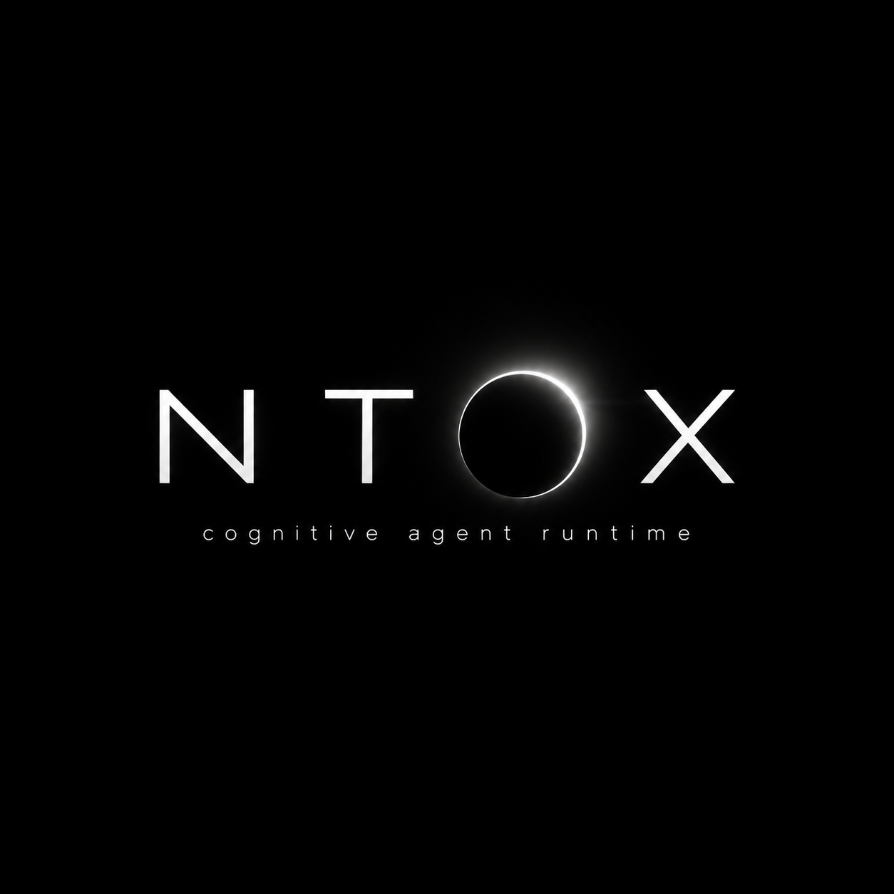
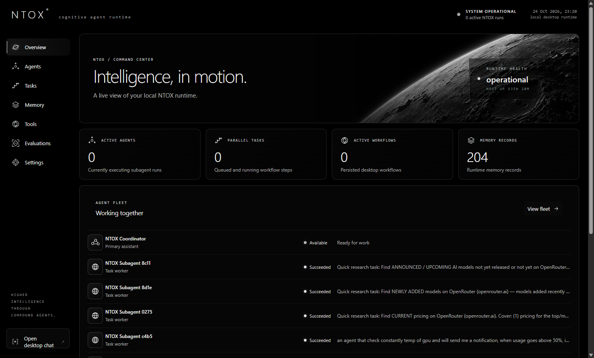
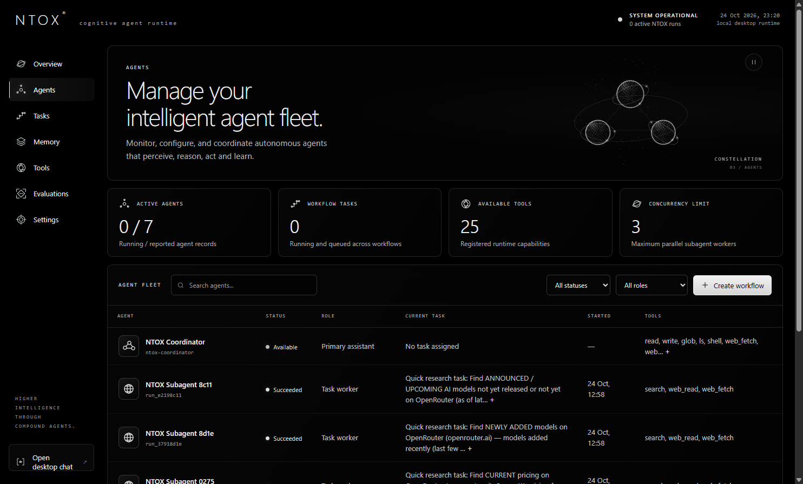
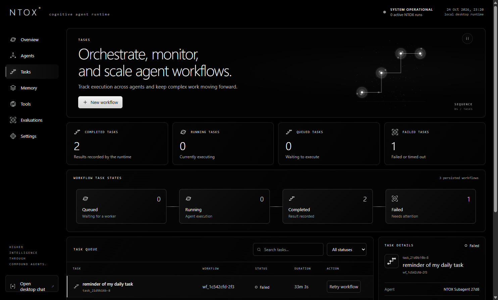
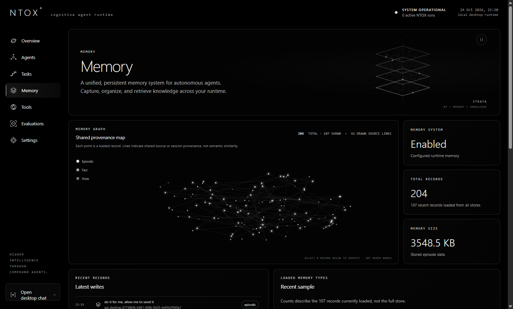
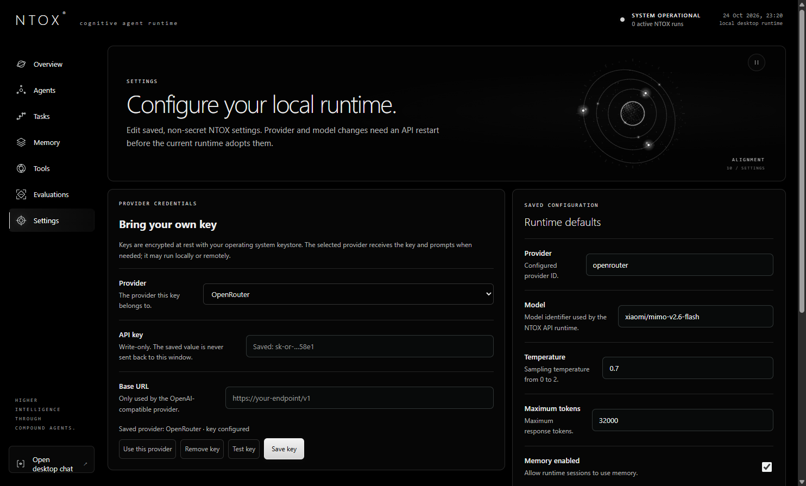
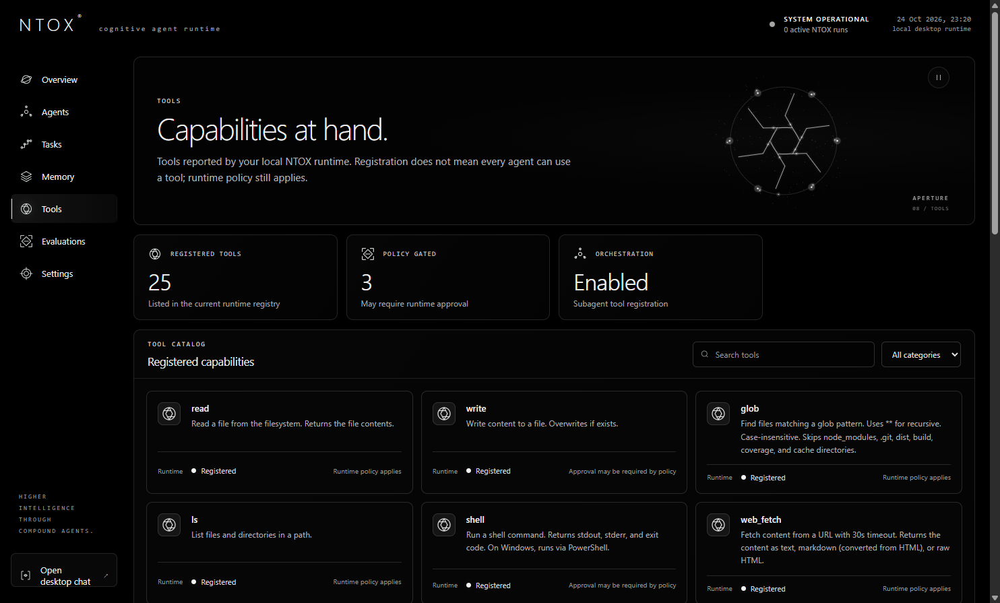
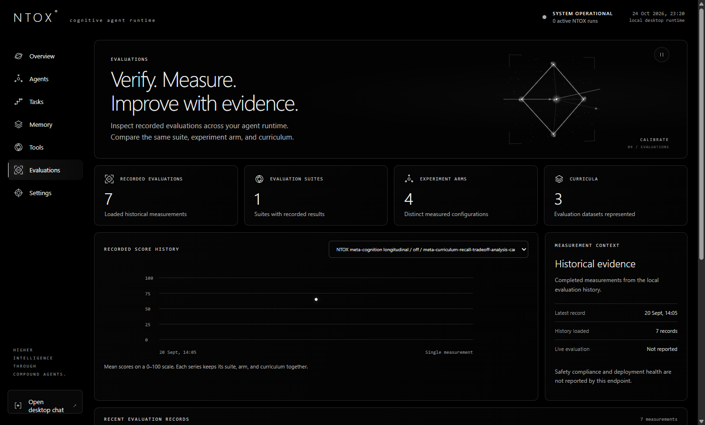

<div align="center">
  

  # NTOX

  **A cognitive CLI agent that predicts, remembers, and corrects itself.**

  [](LICENSE)
  [](package.json)
  [](https://github.com/Ntooxx/Ntox/actions/workflows/ci.yml)
  [](CONTRIBUTING.md)
</div>

---

## What It Does

NTOX is a self-improving AI agent that runs locally. Unlike standard LLM tool loops, it maintains a **closed learning loop**: every turn predicts an outcome, observes what happened, credits the context used, and updates the next turn.

**Core capabilities:**
- **Learns from experience** — corrections outrank conflicting facts, patterns compile into reusable skills
- **Remembers everything** — persistent episodic memory with semantic search: remote embeddings when a provider is configured, local-hash fallback offline, every vector tagged with the embedding model that produced it
- **Self-corrects** — detects shallow reasoning and retries with deeper analysis
- **Writes its own skills** — after a struggling turn it saves a reusable skill to disk (rate-limited, duplicate-protected)
- **Works everywhere** — terminal REPL, Telegram, Discord, WhatsApp, Slack, Web UI, Desktop app
- **Stays local** — runs on your machine, your data never leaves unless you configure a remote provider

---

## Screenshots

### Startup


*NTOX — intelligence that works.*

### Desktop Dashboard



*Command center showing runtime health, active agents, workflow progress, and recent activity.*

### Desktop Chat


*Dedicated conversation surface with streaming responses, history, and agent context.*

### Interface

<table>
  <tr>
    <td align="center"><br><b>Agents</b></td>
    <td align="center"><br><b>Tasks</b></td>
    <td align="center"><br><b>Memory</b></td>
  </tr>
  <tr>
    <td align="center"><br><b>Settings</b></td>
    <td align="center"><br><b>Tools</b></td>
    <td align="center"><br><b>Evaluations</b></td>
  </tr>
</table>

---

## Quick Start

```bash
# macOS / Linux
curl -fsSL https://raw.githubusercontent.com/Ntooxx/Ntox/main/install.sh | bash

# Windows PowerShell
irm https://raw.githubusercontent.com/Ntooxx/Ntox/main/install.ps1 | iex

# Or via npm
npm install -g ntox
ntox setup    # Interactive wizard: API key, model, channels
ntox          # Start chatting
```

---

## Key Features

| Feature | Description |
|---------|-------------|
| **Closed Learning Loop** | Predict → Act → Observe → Attribute → Update → Reuse. Every turn improves the next. |
| **10 LLM Providers** | OpenAI, Anthropic, Ollama, LM Studio, Groq, Together, Mistral, DeepSeek, OpenRouter, any OpenAI-compatible endpoint |
| **Multi-Channel Gateway** | Telegram, Discord, WhatsApp, Slack, Web UI — all sharing one agent runtime |
| **Cognitive Kernel** | Compresses queries to primitives, matches patterns in 8D vector space, auto-compiles frequent patterns |
| **Persistent Memory** | Every exchange embedded and searchable. Corrections outrank conflicting facts. Embeddings are remote-first with a local-hash fallback; every vector is tagged with the model that produced it, and `ntox memory reembed` migrates older entries onto the active model. |
| **Skill Library** | 103 reasoning skills across 18 categories, matched by embeddings when a remote model is configured (keyword triggers offline) |
| **MCP Bridge** | Use external MCP servers as tools, serve NTOX skills to any MCP host |
| **Workspace Policy** | Profiles constrain reads/writes/shell paths. Auto-checkpoints before edits. |
| **Docker Sandboxing** | Optional container isolation for shell commands |
| **Inspectable** | `/trace` shows strategy, tokens, cost, policy decisions, checkpoints, calibration |

---

## Support Matrix

| Surface | Tier | Notes |
|---------|------|-------|
| CLI REPL | Core | Full feature surface; `/mic`, `/speak`, `/voice` and `/voice live on` |
| Voice (REPL) | Core | Configurable STT/TTS providers, identity-driven timbre, mic + playback |
| Voice (live) | Experimental | Realtime speech-to-speech with barge-in; local VAD pipeline fallback |
| Telegram | Core | Voice, approvals, image pipelines |
| Web UI | Core | Chat + static assets |
| HTTP API | Core | REST/SSE server |
| Discord | Best-effort | Gateway contract tests; community-maintained |
| WhatsApp | Best-effort | Gateway + channel contract tests; approvals via reply buttons |
| Slack | Best-effort | Socket-mode contract tests; allowlist enforced |
| MCP bridge | Best-effort | In-memory MCP contract tests; policy and approval covered |
| Marketplace | Best-effort | Bundled offline index + lookup/fetch contract tests |

Electron desktop is **Experimental** and is not part of the shipped support
matrix. It is a thin client over the local API with auth/landscape smoke tests
only and no UI render coverage.

Core surfaces gate every release. Best-effort surfaces merge only with tests,
a README section, and a named owner (see `.github/CODEOWNERS`). Non-shipping
directories (`experiments/`, `glyphs/`, `site/`, `desktop/`) are sandboxed and
excluded from the published npm package; the `marketplace/` index is bundled
for offline skill discovery.

### Best-effort surface details

#### Discord

Setup: set `DISCORD_BOT_TOKEN`, then `npm run gateway discord`. Contract tests
cover token validation, typing, message handling, and error/reconnect paths.
Not supported: slash commands, threads, voice channels, component buttons, or
role-based access control. Known limit: approvals are handled in the CLI/API,
not in Discord; there is no in-channel approval UI.

#### WhatsApp

Setup: configure the Meta Cloud API token, phone id, and webhook verify token;
expose the webhook over HTTPS. Contract tests cover signature validation, text
and caption messages, voice transcription, image attachments, approval reply
buttons, and failure paths. Not supported: groups, status updates, calls, or
outbound template messages outside a reply. Known limit: media is stored in the
local NTOX directory and is subject to its retention policy.

#### Slack

Setup: provide a bot token and app token for socket mode, plus an optional
channel allowlist. Contract tests cover connect, DM replies, mention gating,
allowlist refusals, error replies, and reconnect. Not supported: slash commands,
modals, threads, or file uploads. Known limit: channel messages are answered
only when the bot is mentioned; approvals are not surfaced in-channel.

#### MCP bridge

Setup: add `mcpServers` entries to the NTOX config, each with a stdio `command`
or an HTTP `url`. Contract tests cover connect/list, tool execution, argument
errors, policy denials with interactive approval, disconnect, and reconnect.
Not supported: OAuth flows, resource/prompt negotiation, sampling, or adding
servers at runtime. Known limit: qualified tool names are truncated to 64
characters and remote arguments are validated by the provider schema.

#### Marketplace

Setup: the bundled `marketplace/index.json` works offline; an HTTP index can be
configured for community skills. Contract tests cover index parsing, lookup,
listing, cache/TTL behaviour, stale fallback, and private-network URL blocking.
Not supported: signed packages, version pinning, automatic updates, or paid
skills. Known limit: entries are community-provided and unverified.

---

## Commands

| Command | Description |
|---------|-------------|
| `/help` | Show all commands |
| `/model` | Switch model (live OpenRouter catalog) |
| `/trace` | Inspect last turn: strategy, tokens, cost, policy, injection warnings |
| `/memory` | Browse memory stats |
| `/theories` | Inspect learned theories |
| `/skills` | List/load skills |
| `/approve` | Approve or deny risky shell commands |
| `/new` | Reset conversation |

Full command list: run `/help` inside the REPL (or `ntox --help` for CLI flags).

---

## Architecture

```
ntox/
├── src/
│   ├── cli/           REPL, rendering, animations
│   ├── core/          Agent loop, LLM client (10 providers), config, policy
│   ├── cognition/     Cognitive kernel, pattern store, vector space
│   ├── memory/        Episodic + theory memory, user model
│   ├── meta/          Strategy, reflection, mistakes, proactive
│   ├── skills/        Skill registry, library scanner, executor
│   ├── tools/         Filesystem, shell, grep, web, browser, voice
│   ├── gateway/       Telegram, Discord, WhatsApp, Slack, Web UI
│   ├── api/           HTTP/SSE server
│   └── kernel/        Goals, subtasks, verifier
├── skills/            103 bundled reasoning skill documents
├── desktop/           Electron desktop app
└── screenshots/       UI documentation
```

Non-shipping / sandboxed (not in `package.json.files`): `experiments/`, `glyphs/`,
`site/`, `desktop/`. The `marketplace/` index ships so skill lookup works offline.

---

## Requirements

- **Node.js 18+**
- An LLM provider: OpenRouter, OpenAI, Anthropic, Groq, DeepSeek, Together, Mistral, Ollama, LM Studio, or any OpenAI-compatible endpoint

---

## Testing

```bash
npm run verify:all    # Complete gate: lint, typecheck, tests, build
npm test              # Run tests
npm run typecheck     # TypeScript checks
npm run build         # Build package
```

---

## Security

Defense-in-depth protections:

- **File system**: Blocks `.ssh/`, `.aws/`, `.env`, `.gnupg/`, `.netrc`, `.npmrc`
- **Workspace policy**: Default profile confines read/write/shell to active workspace
- **Web fetch**: Blocks `file://`, `localhost`, all private IP ranges
- **Shell**: Regex blocklist for destructive commands + optional Docker sandboxing
- **Prompt**: risk-tiered injection guard — structural markers block, jailbreak phrasings are stripped and warned
- **Output**: Sanitizes API keys, tokens, private keys from responses
- **Config**: Zod schema validation, `0600` file permissions

Full security policy: [SECURITY.md](SECURITY.md)

---

## DeepSeek Harness Integration

NTOX operates as the cognitive layer inside [DeepSeek Harness](https://github.com/deepseek-ai/deepseek-harness):

```yaml
- id: ntox-cognition
  name: "@ntox/deepseek-harness"
  config:
    cognitionEnabled: true
    memoryEnabled: true
    theoryEnabled: true
```

Harness handles runtime/tools/sessions. NTOX handles cognition/memory/learning/self-correction.

Adapter: [`integrations/deepseek-harness/`](integrations/deepseek-harness/)

---

## Evaluation

NTOX ships a dedicated evaluation harness (not just single-turn quality):

```bash
npm run eval:necessity          # Deterministic mechanism checks (no LLM)
npm run eval:longitudinal       # Cross-turn learning slope per subsystem
npm run bench:alive             # ALIVE-1: trained vs fresh instance
npm run bench:m5                # Full M5: identity, transfer, voice A/B
```

**First powered result** (deepseek-v4-flash, 30 tasks):
- Necessity checks: **6/6 passed**
- Longitudinal `off` vs `all`: Δ = +0.200, 95% CI [0.067, 0.350], **significant**
- Mechanism: cross-session episodic retrieval

Full results: [HIGHLIGHTS.md](HIGHLIGHTS.md)

---

## Contributing

Community-driven open-source project. Bug fixes, gateway plugins, tests, documentation welcome.

See [CONTRIBUTING.md](CONTRIBUTING.md)

---

## License

MIT — see [LICENSE](LICENSE)