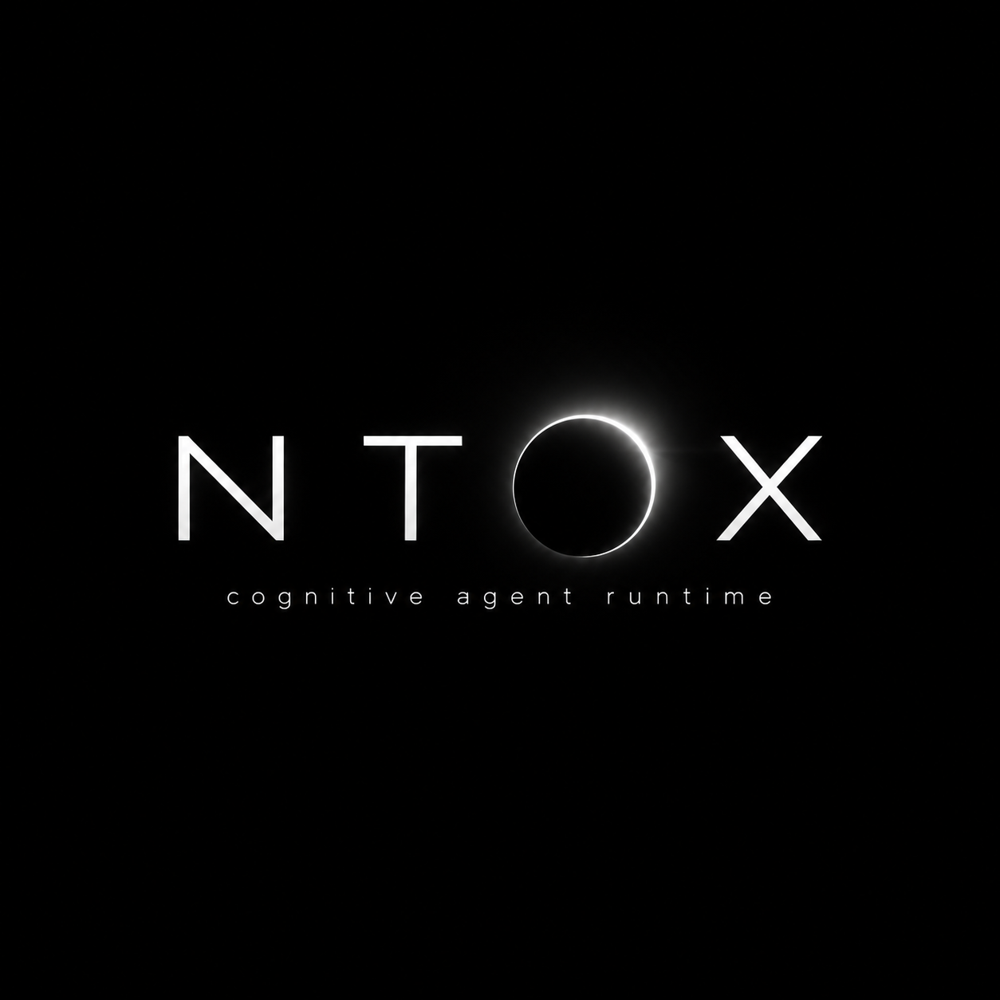
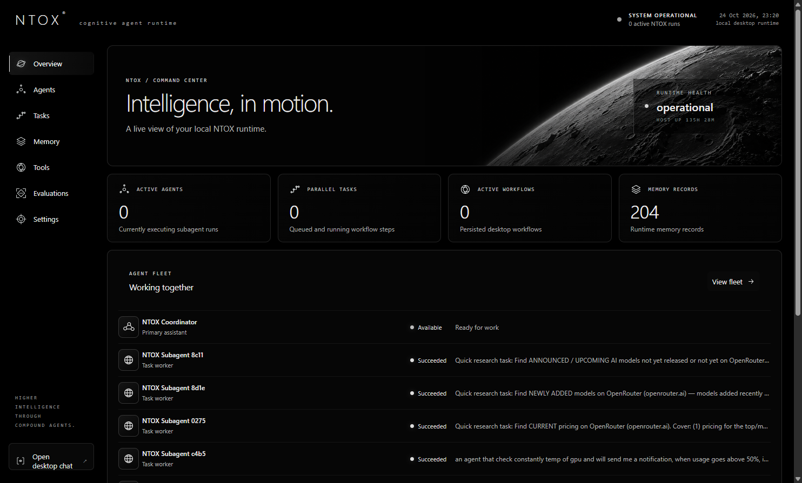
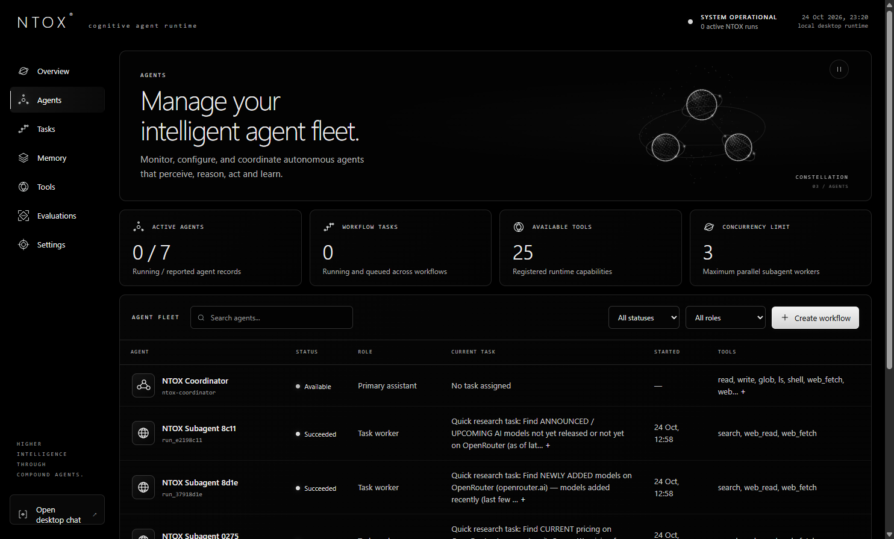
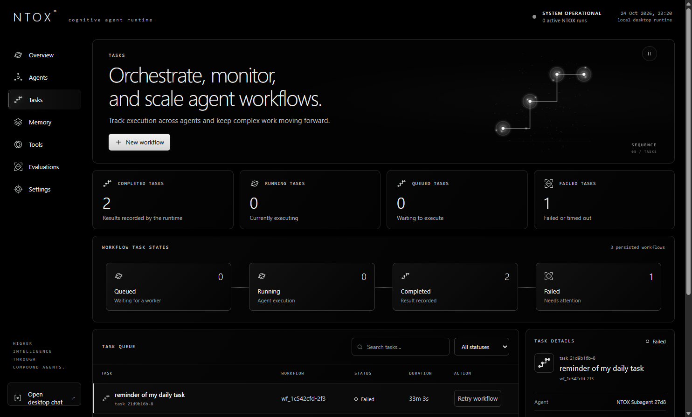
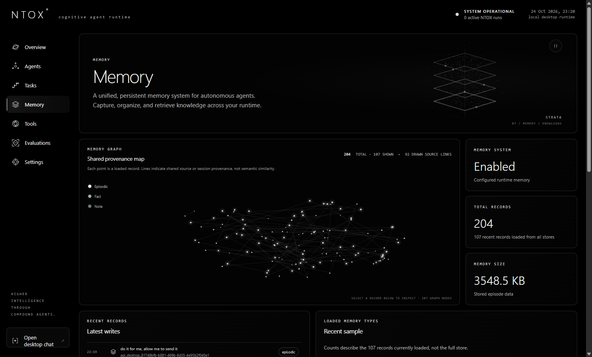
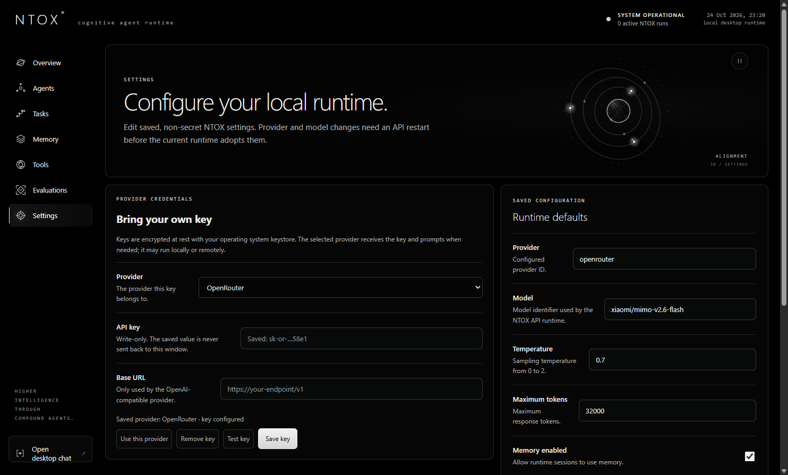
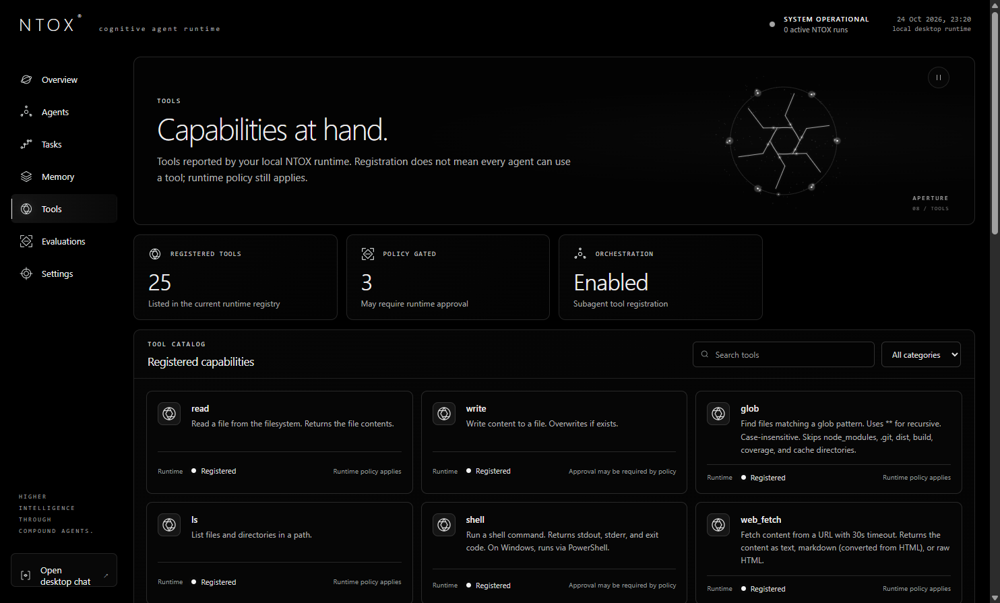
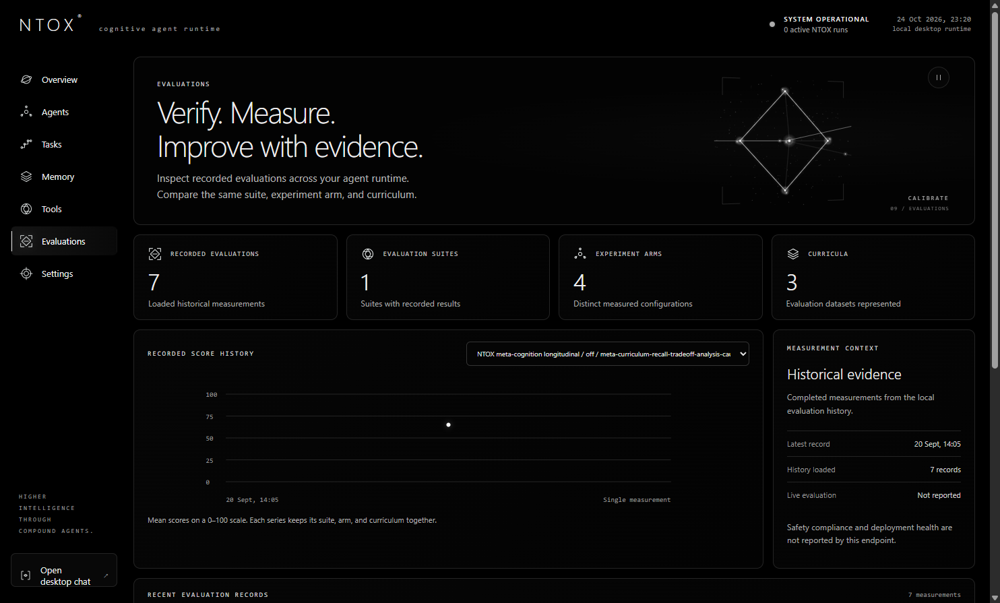

<div align="center">
  

  # NTOX

  **A cognitive CLI agent that predicts, remembers, and corrects itself.**

  [](LICENSE)
  [](package.json)
  [](https://github.com/Ntooxx/Ntox/actions)
  [](CONTRIBUTING.md)
</div>

---

## What It Does

NTOX is a self-improving AI agent that runs locally. Unlike standard LLM tool loops, it maintains a **closed learning loop**: every turn predicts an outcome, observes what happened, credits the context used, and updates the next turn.

**Core capabilities:**
- **Learns from experience** — corrections outrank conflicting facts, patterns compile into reusable skills
- **Remembers everything** — persistent episodic memory with cosine similarity search (local, no API key needed)
- **Self-corrects** — detects shallow reasoning and retries with deeper analysis
- **Works everywhere** — terminal REPL, Telegram, Discord, WhatsApp, Slack, Web UI, Desktop app
- **Stays local** — runs on your machine, your data never leaves unless you configure a remote provider

---

## Screenshots

### Startup


*NTOX — intelligence that works.*

### Desktop Dashboard



*Command center showing runtime health, active agents, workflow progress, and recent activity.*

### Desktop Chat


*Dedicated conversation surface with streaming responses, history, and agent context.*

### Interface

<table>
  <tr>
    <td align="center"><br><b>Agents</b></td>
    <td align="center"><br><b>Tasks</b></td>
    <td align="center"><br><b>Memory</b></td>
  </tr>
  <tr>
    <td align="center"><br><b>Settings</b></td>
    <td align="center"><br><b>Tools</b></td>
    <td align="center"><br><b>Evaluations</b></td>
  </tr>
</table>

---

## Quick Start

```bash
# macOS / Linux
curl -fsSL https://raw.githubusercontent.com/Ntooxx/Ntox/main/install.sh | bash

# Windows PowerShell
irm https://raw.githubusercontent.com/Ntooxx/Ntox/main/install.ps1 | iex

# Or via npm
npm install -g ntox
ntox setup    # Interactive wizard: API key, model, channels
ntox          # Start chatting
```

---

## Key Features

| Feature | Description |
|---------|-------------|
| **Closed Learning Loop** | Predict → Act → Observe → Attribute → Update → Reuse. Every turn improves the next. |
| **10 LLM Providers** | OpenAI, Anthropic, Ollama, LM Studio, Groq, Together, Mistral, DeepSeek, OpenRouter, any OpenAI-compatible endpoint |
| **Multi-Channel Gateway** | Telegram, Discord, WhatsApp, Slack, Web UI — all sharing one agent runtime |
| **Cognitive Kernel** | Compresses queries to primitives, matches patterns in 8D vector space, auto-compiles frequent patterns |
| **Persistent Memory** | Every exchange embedded and searchable. Corrections outrank conflicting facts. |
| **Skill Library** | 107 reasoning skills across 17 categories, matched semantically at prompt time |
| **MCP Bridge** | Use external MCP servers as tools, serve NTOX skills to any MCP host |
| **Workspace Policy** | Profiles constrain reads/writes/shell paths. Auto-checkpoints before edits. |
| **Docker Sandboxing** | Optional container isolation for shell commands |
| **Inspectable** | `/trace` shows strategy, tokens, cost, policy decisions, checkpoints, calibration |

---

## Commands

| Command | Description |
|---------|-------------|
| `/help` | Show all commands |
| `/model` | Switch model (live OpenRouter catalog) |
| `/trace` | Inspect last turn: strategy, tokens, cost, policy |
| `/memory` | Browse memory stats |
| `/theories` | Inspect learned theories |
| `/skills` | List/load skills |
| `/approve` | Approve or deny risky shell commands |
| `/new` | Reset conversation |

Full command list: [README Commands](#commands)

---

## Architecture

```
ntox/
├── src/
│   ├── cli/           REPL, rendering, animations
│   ├── core/          Agent loop, LLM client (10 providers), config, policy
│   ├── cognition/     Cognitive kernel, pattern store, vector space
│   ├── memory/        Episodic + theory memory, user model
│   ├── meta/          Strategy, reflection, mistakes, proactive
│   ├── skills/        Skill registry, library scanner, executor
│   ├── tools/         Filesystem, shell, grep, web, browser, voice
│   ├── gateway/       Telegram, Discord, WhatsApp, Slack, Web UI
│   ├── api/           HTTP/SSE server
│   └── kernel/        Goals, subtasks, verifier
├── skills/            107 bundled reasoning skill documents
├── desktop/           Electron desktop app
└── screenshots/       UI documentation
```

---

## Requirements

- **Node.js 18+**
- An LLM provider: OpenRouter, OpenAI, Anthropic, Groq, DeepSeek, Together, Mistral, Ollama, LM Studio, or any OpenAI-compatible endpoint

---

## Testing

```bash
npm run verify:all    # Complete gate: lint, typecheck, tests, build
npm test              # Run tests (1494 passing)
npm run typecheck     # TypeScript checks
npm run build         # Build package
```

---

## Security

Defense-in-depth protections:

- **File system**: Blocks `.ssh/`, `.aws/`, `.env`, `.gnupg/`, `.netrc`, `.npmrc`
- **Workspace policy**: Default profile confines read/write/shell to active workspace
- **Web fetch**: Blocks `file://`, `localhost`, all private IP ranges
- **Shell**: Regex blocklist for destructive commands + optional Docker sandboxing
- **Prompt**: 14 injection pattern detectors (DAN, jailbreak, override, etc.)
- **Output**: Sanitizes API keys, tokens, private keys from responses
- **Config**: Zod schema validation, `0600` file permissions

Full security policy: [SECURITY.md](SECURITY.md)

---

## DeepSeek Harness Integration

NTOX operates as the cognitive layer inside [DeepSeek Harness](https://github.com/deepseek-ai/deepseek-harness):

```yaml
- id: ntox-cognition
  name: "@ntox/deepseek-harness"
  config:
    cognitionEnabled: true
    memoryEnabled: true
    theoryEnabled: true
```

Harness handles runtime/tools/sessions. NTOX handles cognition/memory/learning/self-correction.

Adapter: [`integrations/deepseek-harness/`](integrations/deepseek-harness/)

---

## Evaluation

NTOX ships a dedicated evaluation harness (not just single-turn quality):

```bash
npm run eval:necessity          # Deterministic mechanism checks (no LLM)
npm run eval:longitudinal       # Cross-turn learning slope per subsystem
npm run bench:alive             # ALIVE-1: trained vs fresh instance
npm run bench:m5                # Full M5: identity, transfer, voice A/B
```

**First powered result** (deepseek-v4-flash, 30 tasks):
- Necessity checks: **6/6 passed**
- Longitudinal `off` vs `all`: Δ = +0.200, 95% CI [0.067, 0.350], **significant**
- Mechanism: cross-session episodic retrieval

Full results: [HIGHLIGHTS.md](HIGHLIGHTS.md)

---

## Contributing

Community-driven open-source project. Bug fixes, gateway plugins, tests, documentation welcome.

See [CONTRIBUTING.md](CONTRIBUTING.md)

---

## License

MIT — see [LICENSE](LICENSE)